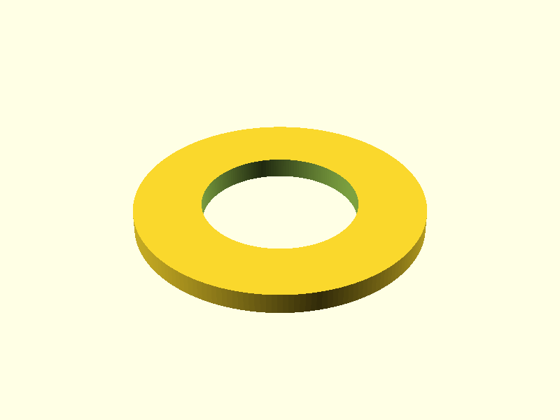

# Faucet washer

> Norsk versjon: [README.no.md](README.no.md)

A flat, solid washer for a faucet: **56 mm** across, **4 mm** thick, with a
**30 mm** hole in the middle.

## Printing

The STL is in [stl/faucet_washer.stl](stl/faucet_washer.stl). Rebuild it with

    openscad -o stl/faucet_washer.stl faucet_washer.scad

The model is already a solid body. How much of the inside gets filled is not
part of the model – an STL only describes the outer surface – so it is set in
the slicer:

| Setting | Value | Why |
|---|---|---|
| Infill density | 100 % | the washer is clamped, so it should not crush |
| Infill pattern | rectilinear / lines | the usual choice for solid infill |
| Orientation | flat on the bed | as exported, no supports needed |

In PrusaSlicer and OrcaSlicer it is *Infill → Fill density = 100 %*, in Cura
*Infill Density = 100 %*. Setting the number of perimeters and top/bottom layers
high enough gives the same result.
