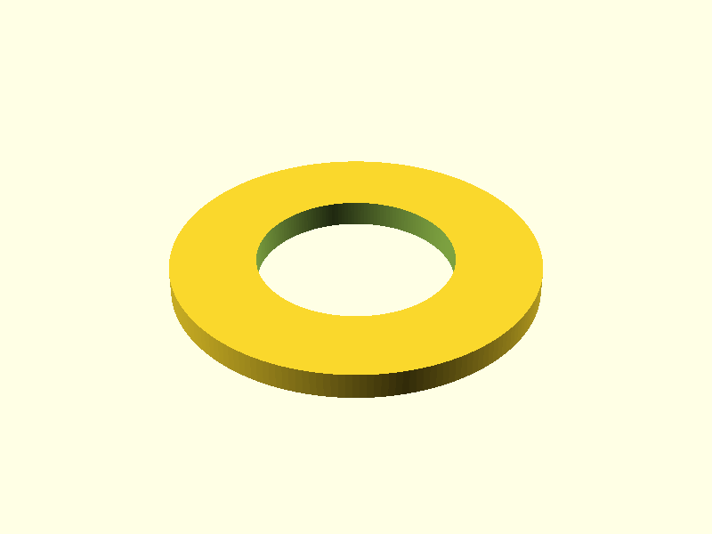

# Skive til kran

> English version: [README.md](README.md)

En flat, massiv skive til en kran: **56 mm** i diameter, **4 mm** tykk, med et
hull på **30 mm** i midten.

## Utskrift

STL-fila ligger i [stl/faucet_washer.stl](stl/faucet_washer.stl). Lag den på
nytt med

    openscad -o stl/faucet_washer.stl faucet_washer.scad

Modellen er allerede et massivt legeme. Hvor mye av innsiden som fylles er ikke
en del av modellen – en STL beskriver bare overflaten – så det settes i
sliceren:

| Innstilling | Verdi | Hvorfor |
|---|---|---|
| Infill density | 100 % | skiven klemmes, så den skal ikke gi etter |
| Infill pattern | rectilinear / lines | det vanlige valget for massiv fylling |
| Orientering | flatt på platen | slik den er eksportert, ingen support |

I PrusaSlicer og OrcaSlicer er det *Infill → Fill density = 100 %*, i Cura
*Infill Density = 100 %*. Nok perimetre og topp-/bunnlag gir samme resultat.
